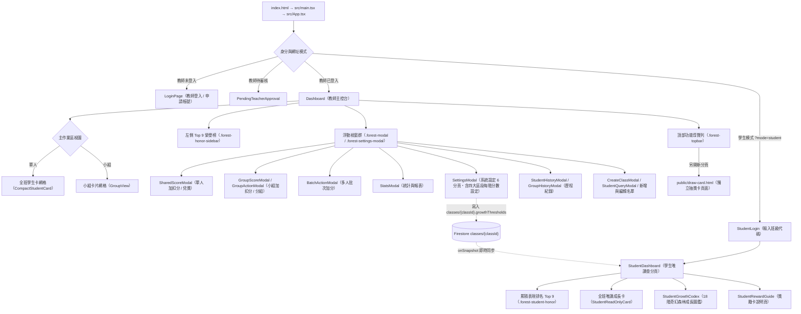

# 合作型積分平台（studentpoints）：網站架構與風格抽換完整規格

> 依據最新提交 `118b94d`（18 階段成長樹 + 奇幻森林成長圖鑑 + 四大區段每階倍數門檻設定）實際程式碼與圖檔實測整理。下次要更換視覺主題時，請依本文件替換圖片與調整 CSS，並保持 React 元件邏輯、Firebase 資料流程、積分計算與響應式版面不變。

---

## 一、網站整體架構



### 成長分數區間設定與即時同步機制
- **四大區段每階倍數輸入**（`SettingsModal` →「獎勵設定」，`src/App.tsx`）：
  - 第 1 區段（1–4 階，共 4 階）：預設每階 **`30`** 分（`0、30、60、90`）
  - 第 2 區段（5–8 階，共 4 階）：預設每階 **`40`** 分（`120、160、200、240`）
  - 第 3 區段（9–12 階，共 4 階）：預設每階 **`50`** 分（`280、330、380、430`）
  - 第 4 區段（13–17 階，共 5 階）：預設每階 **`60`** 分（`480、540、600、660、720`；第 18 階滿級 `780` 分以上）
- **即時預覽與雙向換算**：
  - 輸入任一區段每階正整數（1–5000）時，下方「**18 階門檻預覽**」即時顯示全部 18 階分數；儲存時由 `growthThresholdsFromSteps()` 自動換算成 4 個累積里程碑（預設 `[120, 280, 480, 780]`）存入既有欄位 `classes/{classId}.growthThresholds`（無須修改 Firestore Rules）。
- **學生端即時同步**：`StudentDashboard` 以 `onSnapshot` 即時監聽 `classes/{classId}`，教師儲存後，學生端的**全班唯讀成長卡**與**奇幻森林成長圖鑑**（各階門檻、探索進度、距下一階差幾分與解鎖狀態）立即同步更新。

### 專案目錄職責
| 檔案／資料夾 | 角色 | 抽換風格時是否需動 |
|---|---|---|
| `src/index.css` | 整個 React 網站的**風格核心**（色票變數、背景、卡片、按鈕、圖鑑、響應式） | **必改** |
| `src/App.tsx` | 所有 React 頁面、元件、圖片路徑常數與字級設定 | 僅換圖檔時**免改**；若改圖檔名、成長階數或文案才需改 |
| `public/forest-assets/` | 教師主控台背景、頂欄枝葉、榮譽榜木牌與金銀銅獎牌、學生卡角落枝葉 | **必換** |
| `public/forest-assets/growth-stages-18/` | **現行正式使用的 18 階段成長樹圖檔**（`01`～`18`） | **必換** |
| `public/reward-cards/` | 抽獎卡與學生獎勵說明頁的 17 張獎卡圖 | 選換（若連獎卡一起換主題） |
| `public/draw-card.html` | 獨立靜態抽獎頁（自帶獨立 CSS 與備用 SVG，不吃 `src/index.css`） | 選換（若連抽獎頁一起換風格） |
| `firestore.rules`、`apps-script/Code.gs` | 資料庫權限與 Google 試算表備份 | **不可動** |

---

## 二、抽換風格必換圖片總表（含實測格式與規格）

### 1. 必換核心圖片（現行程式實際使用：**共 25 張**）

| 分類 | 檔名與路徑 | 現行格式／色彩 | 現行實測尺寸與比例 | 套用位置與 CSS / 程式規則 | 抽換構圖注意事項 |
|---|---|---|---|---|---|
| **教師首頁全頁背景** | `public/forest-assets/teacher-dashboard-paper-forest.png` | PNG（RGB，不透明） | `1672×941`（**16:9**） | `.forest-dashboard`（`background-size: cover, 100vw 100vh; background-attachment: fixed`） | 中央約 60% 維持低對比淺色留白給卡片與文字，主要風景放四周與底部；建議 < 1.5 MB。 |
| **頂端導覽列背景** | `public/forest-assets/teacher-topbar-forest-overlay.png` | PNG（**RGBA 透明**） | `2172×724`（**3:1**） | `.forest-topbar::before`（`background-size: 100% 100%; opacity: 0.86`） | 裝飾集中在左右兩側，中央 50% 保持透明不遮擋班級選單與功能按鈕。 |
| **左側榮譽榜框架** | `public/forest-assets/honor-board-frame.png` | PNG（**RGBA 透明**） | `793×1983`（**0.4:1 直式**） | `.forest-honor-sidebar`（`background: center / 100% 100% no-repeat`） | 上方約 `top: 7%` 留出標題區（**圖內不可畫文字**）；中段留白給 9 張排名卡（padding 上 `8.8rem`、下 `5.8rem`）。 |
| **前三名獎牌（3 張）** | `honor-medal-gold.png`<br>`honor-medal-silver.png`<br>`honor-medal-bronze.png` | PNG（**RGBA 透明**） | `1254×1254`（**1:1**） | `.forest-honor-list .forest-honor-card:nth-child(1..3) > div:nth-child(1)`（顯示大小 `2.55rem×2.55rem`） | **圖內不可畫數字**；中央內圓留白由程式疊字。第 1 名因上方有皇冠，數字圓心固定在 `top: 60%`；第 2、3 名置中 `50%`。 |
| **學生卡右上角裝飾** | `public/forest-assets/student-card-leaves-top-right.png` | PNG（**RGBA 透明**） | `1254×1254`（**1:1**） | `.forest-student-card::before`（`width/height: 3.65rem; opacity: 0.42; top/right: -0.25rem`） | 圖案貼齊右上角，避免干擾姓名；淡雅點綴即可。 |
| **18 階段成長樹（18 張）** | `public/forest-assets/growth-stages-18/student-growth-stage-01.png` ～ `18.png` | PNG（**RGBA 透明**） | `1280×1600`（**4:5 直式**） | `.forest-growth-stage-0`～`17` 與 `growthStageImageUrl()`（同時用於學生卡與成長圖鑑） | **重要構圖規格**：畫布為 **4:5**，**上方保留約 37% 透明留白、下方約 7% 透明留白**，讓程式統一用 `width: 106%; height: min(166%, 132.5cqi); transform: translateY(7.2%)` 貼底顯示而不蓋到分數；**圖鑑 1–12 階未解鎖會直接將本圖套用 CSS 剪影濾鏡**，所以輪廓需辨識度高。 |

> **已停用／舊版殘留圖檔（抽換風格時不需更換）**：
> - `public/forest-assets/student-card-grass-bottom-left.png`、`student-card-grass-bottom-right.png`（已從學生卡 CSS 移除，讓成長樹當主角）。
> - `public/forest-assets/student-growth-stage-0.png` ～ `student-growth-stage-8.png`（舊版 1:1 素材，現行程式已全部改指 `growth-stages-18/student-growth-stage-01..18.png`）。

### 2. 選換圖片與內嵌裝飾（獨立模組）
| 分類 | 路徑與檔名 | 現行實測格式與尺寸 | 備註 |
|---|---|---|---|
| **抽獎卡／獎勵說明圖（17 張）** | `public/reward-cards/*.jpg`（如 `snack_1.jpg`、`super_lucky.jpg` 等 17 張） | 尺寸皆為 `1728×2432`（**約 0.71:1 直式**） | 支援 JPG／PNG／WebP（建議單張壓縮 < 2 MB）；檔名需與程式清單或「系統設定 → 抽獎卡」登錄檔名一致。 |
| **成長圖鑑 13–18 階封印圖** | 內嵌於 `src/App.tsx` 的 `<svg>`（`StudentGrowthCodex`） | 向量 SVG（`viewBox="0 0 120 120"`） | 非外部圖片檔；換非森林主題時（例如海洋、太空）可改畫對應的神秘封印圖示（如貝殼、星核）。 |
| **學生登入頁上方圖示** | `.forest-student-login-card::before`（`src/index.css`） | Emoji 字元 `🌱`（圓形底 `4rem×4rem`） | 改 CSS `content` 即可換成對應主題符號或圖示。 |

### 3. 全部圖片的共通規格
- 角落插圖、獎牌與 18 階段成長圖使用透明 PNG 或 WebP，不要有白色方形底。
- 不把姓名、分數、名次、榮譽榜標題或其他動態文字畫進圖片，全部由網頁程式疊加顯示。
- 大型背景的重要物件應放在邊緣，避免不同螢幕比例裁切到中央內容。
- 建議大型背景壓縮在約 1.5 MB 內；單張成長圖與獎牌盡量最佳化檔案大小以維持 GitHub Pages 載入速度。
- 換圖後至少測試桌機、平板與手機寬度，確認所有文字、座號、按鈕與分數均未被圖片遮住。

---

## 三、各類圖卡（Cards）結構、尺寸與樣式標註

### 1. 學生卡（教師端 `CompactStudentCard` & 學生端 `StudentReadOnlyCard`）
- **CSS 類別**：`.forest-student-card`（容器外框 `.forest-student-grid`）
- **網格排列**：`grid-cols-3 sm:grid-cols-5 lg:grid-cols-7 xl:grid-cols-9 gap-2`
- **卡片比例與外觀**：
  - 比例：`aspect-ratio: 4 / 5`（固定直式 4:5，由外層欄寬決定尺寸）
  - 圓角：`15px`、邊框 `1px solid #7f9d62`、半透明底 `rgba(255,252,240,.72)`、輕陰影
  - 選取狀態（`ring-2`）：邊框轉主色 `var(--forest-moss)`、底色轉 `var(--forest-sage-pale)`
- **內部三列 × 四欄結構**：
  1. **第 1 列（橫向 4 等分 `repeat(4, minmax(0, 1fr))`）**：
     - **座號圓章**（`.forest-student-seat`，第 1 格靠左）：圓形 `clamp(1.3rem, 20cqi, 1.65rem)`、字級 `0.72rem` 粗體、底色 `var(--forest-sage-pale)`、邊框 `#c9dbc2`。
     - **學生姓名**（`.forest-student-name`，第 2–4 格靠左）：字級 `clamp(1.12rem, 16.8cqi, 1.44rem)`（教師端會乘上 `studentFontScale` 80%–160%）、粗體 `800`、`#35483b`，超長自動 `truncate`。
  2. **第 2 列（跨滿 4 格，雙色純數字分數）**：
     - `.forest-student-score`：字級 `clamp(0.92rem, 13.2cqi, 1.12rem)`、等寬數字 `tabular-nums`、`flex-wrap: wrap`（寬度足夠單行，窄卡自動兩行不溢位）。
     - **可用分數**（`.forest-score-available`）：琥珀色 `#a16207`（負分自動轉紅 `var(--forest-danger)`），預留 `min-width: 3ch`。
     - **分隔符**（`.forest-score-divider`）：`/`，淡灰綠 `#9cb096`。
     - **累積分數**（`.forest-score-performance`）：森林綠 `#397144`，預留 `min-width: 3ch`。
  3. **第 3 列（跨滿 4 格，剩餘高度 `minmax(0, 1fr)`）**：
     - `.forest-growth-plant`：`width: 106%; height: min(166%, 132.5cqi); transform: translateY(7.2%)`，貼底等比顯示 `01`～`18` 階成長圖。

### 2. 榮譽榜卡片（Top 9）
- **教師端側邊欄（`.forest-honor-sidebar` → `.forest-honor-list .forest-honor-card`）**：
  - 寬度：`minmax(180px, 208px)`（`< 1024px` 移至上方改 2 欄，`< 640px` 改 1 欄）。
  - 單張結構：3 欄橫列（`2.35rem minmax(0, 1fr) auto`），最小高 `3.7rem`，圓角 `13px`，底色 `rgba(255,253,244,.93)`、邊框 `#eadcc0`。
  - 左側名次：第 1–3 名套用金／銀／銅獎牌 PNG（`2.55rem`）；第 4–9 名為漸層圓章（`2.1rem`）。
- **學生端榮譽榜（`.forest-student-honor`）**：
  - 橫向卡片網格：`grid-cols-3 sm:grid-cols-5 lg:grid-cols-9 gap-2`，高度 `h-32 sm:h-36`，左上角圓形名次徽章（`h-7 w-7`），中央放大姓名與累積分數。

### 3. 奇幻森林成長圖鑑卡（`StudentGrowthCodex`，`.forest-codex-card`）
- **網格排列**：`grid-cols-2 sm:grid-cols-3 lg:grid-cols-4 gap-3 sm:gap-4`，圓角 `1rem`（`rounded-2xl`），圖框比例 `aspect-ratio: 4 / 3.3`。
- **動態門檻同步**：每張圖鑑卡的解鎖分數與頂部進度條均由 `growthStageMilestonesFor(growthThresholds)` 即時推算，與教師端四大區段每階設定即時聯動。
- **四種視覺狀態**（定義於 `src/index.css`）：
  1. **已解鎖一般卡**（`.forest-codex-unlocked`）：奶油紙漸層底、淺綠邊框 `#b7cea9`，顯示彩圖、階段名稱、前五位解鎖座號徽章與解鎖人數。
  2. **已解鎖最終滿級卡**（`.forest-codex-final`）：暖金漸層底、金邊 `#d6b15c` 與金色微光陰影。
  3. **1–12 階未解鎖剪影卡**（`.forest-codex-silhouette`）：虛線邊框 `#c2d1ba`、淡霧綠底，圖片套用 CSS 剪影濾鏡（`.forest-codex-tree-silhouette`）＋中央圓形 `?` 徽章（`.forest-codex-question-badge`）。
  4. **13–18 階神秘種子封印卡**（`.forest-codex-sealed` / `.forest-codex-sealed-final`）：深森夜空漸層底（`#1b3629`～`#242642`）、金邊、發光光暈＋SVG 神秘種子＋`?`。

### 4. 小組卡（`GroupView`，`.forest-group-card`）
- **容器**：`.forest-group-grid`（圓角 `18px`，暖米半透明底 `rgba(245,237,211,.34)`）。
- **卡片外觀**：半透明紙底 `rgba(255,252,240,.64)`、圓角 `rounded-xl`、頂部標題列與底部操作列（`.forest-group-card-footer`）採淡綠底 `rgba(237,245,229,.58)`；hover 時微浮起 `translateY(-1px)`。

### 5. 浮動視窗與設定面板（`.forest-modal`、`.forest-settings-modal`、`.forest-score-modal`）
- **遮罩**：`.forest-modal-overlay`（半透明深森綠 `rgba(29, 51, 35, .48)` + `backdrop-blur-sm`）。
- **視窗本體**：暖白紙底 `#fffef9`、圓角 `18px`、邊框 `var(--forest-line)`、最大高度 `calc(100dvh - 2rem)`。
- **標題列**：`.forest-modal-titlebar` / `.forest-settings-titlebar` / `.forest-score-modal-titlebar` 皆採主色漸層 `linear-gradient(105deg, var(--forest-moss-deep), var(--forest-moss))`。
- **設定分頁列**：`.forest-settings-tabs`（底色 `#f5f7f1`，選中頁籤白底＋綠框 `#cadbc2`＋主色文字）。
- **獎勵設定 → 成長分數區間面板**：淡草綠區塊（`border-lime-200 bg-lime-50/60 rounded-lg p-3`），內含 4 格每階分數輸入欄（`grid-cols-2 sm:grid-cols-4`，預設 `30 / 40 / 50 / 60`）、即時 18 階門檻預覽列（白底半透明 `bg-white/65`），以及「套用預設（30/40/50/60）」與「儲存成長分數區間」操作列。

### 6. 學生獎勵卡說明頁（`StudentRewardGuide`）與抽獎頁（`public/draw-card.html`）
- **獎勵卡說明卡**（`.forest-student-guide article`）：暖羊皮紙漸層底（`rgba(241,232,204,.98)` → `rgba(228,215,176,.96)`），搭配 `public/reward-cards/*.jpg`（`1728×2432`）。
- **抽獎卡獨立頁**（`public/draw-card.html`）：獨立色票（`--bg-sky: #FFF9E6`、`--primary-red: #FF5964`、`--primary-yellow: #FFCA3A` 等），圓體字型 `Zen Maru Gothic`，粗黑框膠囊按鈕與扭蛋動畫；內嵌 SVG 僅作為缺圖時的備用插圖。

---

## 四、按鈕樣式與圖示清單（完全無圖片檔，純 CSS + Lucide 圖示）

本網站**沒有任何點陣圖片按鈕**，所有按鈕皆由 **Lucide SVG 圖示** + **Tailwind 類別** + **`src/index.css`** 統一換色：

| 按鈕類型 | 位置範例 | 程式寫法／選擇器 | 現行森林風樣式 | 抽換風格改法 |
|---|---|---|---|---|
| **主要行動按鈕（實心）** | 頂欄「多人加分」「統計」「抽獎卡」「學生管理」、建立班級、儲存表單 | `.forest-app button[class*="bg-indigo-600"]` 等 6 種 Tailwind 實心色被統一覆寫 | 底色 `var(--forest-moss)`（`#315c3b`）、hover `var(--forest-moss-deep)`（`#23472d`）、白字、圓角 `8px`（`rounded-lg`）、`px-3 py-2 text-sm` | **只需改 `:root` 的 `--forest-moss` 與 `--forest-moss-deep`**，全站主按鈕即同步換色。 |
| **次要／圖示按鈕（白底外框）** | 頂欄「備份上傳」「系統設定」「登出」、返回按鈕 | `bg-white border border-slate-200 text-slate-600 rounded-lg`（登出為 `bg-slate-100`） | 白底／淺灰底、圓角 `8px`、配 16px（`w-4 h-4`）Lucide 圖示 | 可在 `src/index.css` 新增 `.forest-topbar button` 統一樣式（邊框色、圓角、hover 底色）。 |
| **視圖切換膠囊組** | 頂欄「單人／小組」切換（`.forest-top-view-switcher`） | 外框淡綠底 `rgba(237,243,232,.82)`、圓角 `10px` | 選中項白紙底 `#fffef9`＋主色圖示＋陰影；未選中灰字 | 調整 `.forest-top-view-switcher` 與 `.forest-view-switcher`。 |
| **加分／兌獎項目大方塊按鈕** | 單人／小組加扣分彈窗（`.forest-score-grid > button`） | 依類別套用 `bg-blue`（加分）、`bg-amber`（兌獎）、`bg-pink`（扣分） | 最小高 `5.25rem`（手機 `4.75rem`）、圓角 `12px`；加分／兌獎為淺綠漸層底＋深綠字；扣分為淺粉紅漸層底＋深紅字 `#a53b32` | 調整 `src/index.css` 的 `.forest-score-grid > button` 區塊。 |
| **危險／刪除按鈕** | 刪除班級、刪除學生、重設等 | 保留原本紅色（`bg-red-*` / `text-red-*`），刻意不被 `--forest-moss` 覆寫 | 維持警示紅（`--forest-danger: #bd3d3d`） | 建議維持高辨識紅色以防誤刪。 |
| **學生端標頭入口按鈕** | 學生查分頁「成長圖鑑」「查看獎勵卡說明」 | `rounded-lg border px-3 py-2 text-sm font-bold`（`lime-50` 與 `emerald-50`） | 淺草綠／淡翠綠底配深綠字與 `BookOpen`／`Award` 圖示 | 可於 `.forest-student-dashboard` 內覆寫。 |
| **成長區間設定操作按鈕** | 設定 → 獎勵設定「套用預設（30/40/50/60）」「儲存成長分數區間」 | 預設鈕 `border-lime-300 bg-white text-lime-800`；儲存鈕 `bg-lime-700 text-white`（皆 `rounded-lg py-2`） | 白底草綠框次按鈕搭配實心草綠儲存主按鈕 | 換主題時可改以主色變數或 `.forest-settings-content` 統一樣式。 |

---

## 五、全站色彩變數速查表（換主題第一步）

只要先修改 `src/index.css` 的 `:root` 變數，再替換上述 25 張圖片，全站 80% 以上的視覺風格就會同步完成切換：

```css
:root {
  --forest-moss: #315c3b;        /* 全站主色（實心按鈕、強調文字、選取外框） */
  --forest-moss-deep: #23472d;   /* 主色深階（按鈕 hover、標題列漸層起點、品牌字） */
  --forest-sage: #9ab889;        /* 輔助柔和色（hover 邊框、focus 光暈、裝飾符號） */
  --forest-sage-pale: #edf3e8;   /* 淺底強調色（座號圓章、選取卡片底、淺色標籤） */
  --forest-paper: #f7f1e4;       /* 全頁基底紙色 */
  --forest-ink: #294032;         /* 全站主要文字深色 */
  --forest-line: #d9e1d2;        /* 卡片與面板外框線色 */
  --forest-danger: #bd3d3d;      /* 負分與危險警示色 */
  --forest-shadow: 0 8px 24px rgba(51, 76, 53, .08);
}
```

---

## 六、抽換流程

1. 先建立或選定新的完整視覺主題。
2. 依第二節表格替換對應的 25 張核心圖片（透明裝飾、獎牌與 18 階段成長圖需保留透明背景與 4:5 留白比例）。
3. 視新風格調整 `src/index.css` 的 `:root` 色票、卡片底色、圖鑑剪影／封印卡漸層、邊框與陰影；不更動積分計算、登入、Firebase 或資料欄位程式。
4. 檢查榮譽榜標題是否仍置於框架中央、前三名數字是否仍位於獎牌內圓中心、學生卡座號／姓名／雙色分數是否未被成長圖與角落圖遮住，以及成長圖鑑剪影與封印卡顯示是否正常。
5. 執行 `npm run check`、`npm run build`、`npm run check:pages` 後，再提交推送。

### 下次可直接使用的指令

> 請依 `STYLE_ASSETS.md` 抽換網站視覺風格；只更換列出的 25 張核心圖片與必要 CSS，不改動所有既有功能、Firebase 資料流程、積分規則與響應式版面。完成後進行本機測試。
